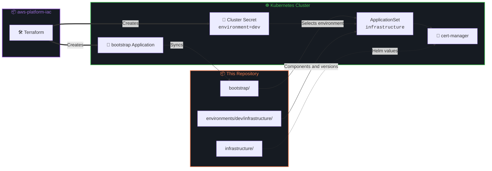

# AWS Platform GitOps


The GitOps side of a Kubernetes platform on AWS. **Argo CD** installs everything on the cluster from this repository, using a single **ApplicationSet** that combines cluster metadata with the components listed per environment.

The cluster, Argo CD and the connection to this repository are provisioned by Terraform in [aws-platform-iac](https://github.com/infrasam/aws-platform-iac).

---

## Architecture Overview



**How it works:**

1. Terraform registers the cluster in Argo CD with a **cluster Secret** labelled with its environment, and creates one **bootstrap** Application
2. The bootstrap Application syncs `bootstrap/`, which contains the `infrastructure` ApplicationSet
3. The ApplicationSet uses a **matrix generator**: for every registered cluster, it reads every file in `environments/<environment>/infrastructure/`
4. Each file becomes one Application that installs a Helm chart with the version from that file, the shared values from `infrastructure/<name>/` and, if present, the environment's overrides from `environments/<environment>/infrastructure/values/`

---

## Components

| Component | Description |
|-----------|-------------|
| **cert-manager** | Issues and renews TLS certificates, CRDs installed with the chart |

---

## Repository Structure

```
.
├── bootstrap/                      # Synced by the bootstrap Application
│   └── applicationset-infra.yaml   #   ApplicationSet for all infrastructure components
│
├── environments/                   # WHAT runs where, and which version
│   └── dev/
│       └── infrastructure/
│           ├── cert-manager.yaml   #   Chart, repository, version, namespace
│           └── values/             #   Optional overrides for this environment
│
└── infrastructure/                 # HOW a component is configured
    └── cert-manager/
        └── values.yaml             #   Helm values shared by all environments
```

---

## Adding a Component

1. Create `environments/<environment>/infrastructure/<name>.yaml` with the chart, repository, version and namespace
2. Create `infrastructure/<name>/values.yaml` with its settings
3. Open a pull request. After merge, the ApplicationSet discovers the file and Argo CD installs the component

No change to the ApplicationSet is needed.

---

## Key Design Decisions

- **ApplicationSet instead of app of apps**: one template creates every Application, so adding a component never means writing another Application manifest
- **Versions per environment, values layered**: each environment pins its own chart versions, and shared values can be overridden per environment in `environments/<environment>/infrastructure/values/`, so a change is tested in dev before it reaches other environments
- **Environment comes from the cluster**: the cluster Secret decides which folder a cluster reads, so a new cluster with the same label gets the same components automatically
- **Multi-source Applications**: the chart comes from its upstream Helm repository and the values from this repository, so no charts are vendored
- **One entry point**: Terraform creates a single object and knows nothing about the content of this repository
